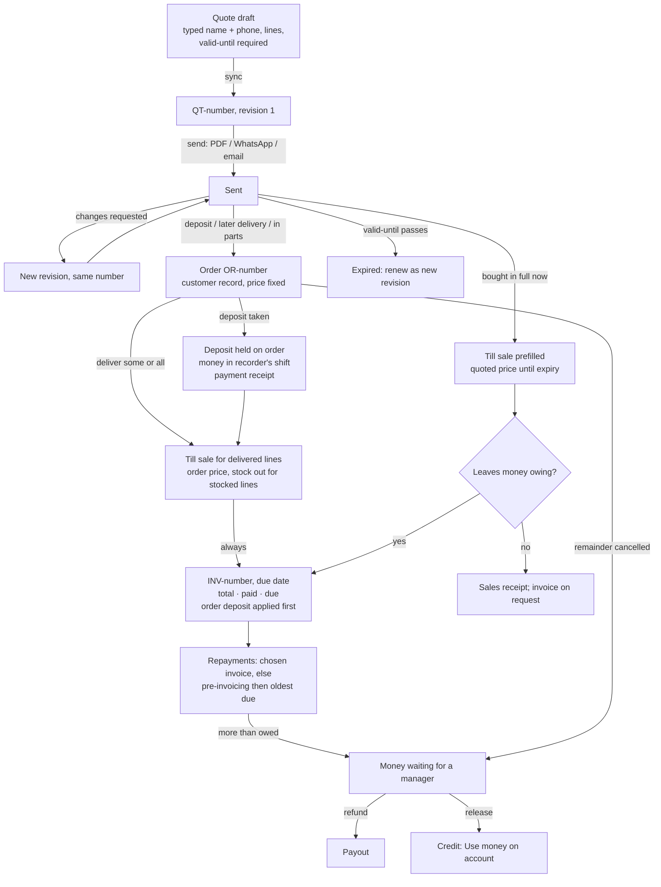
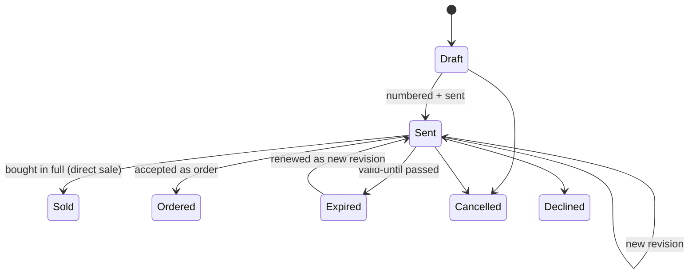
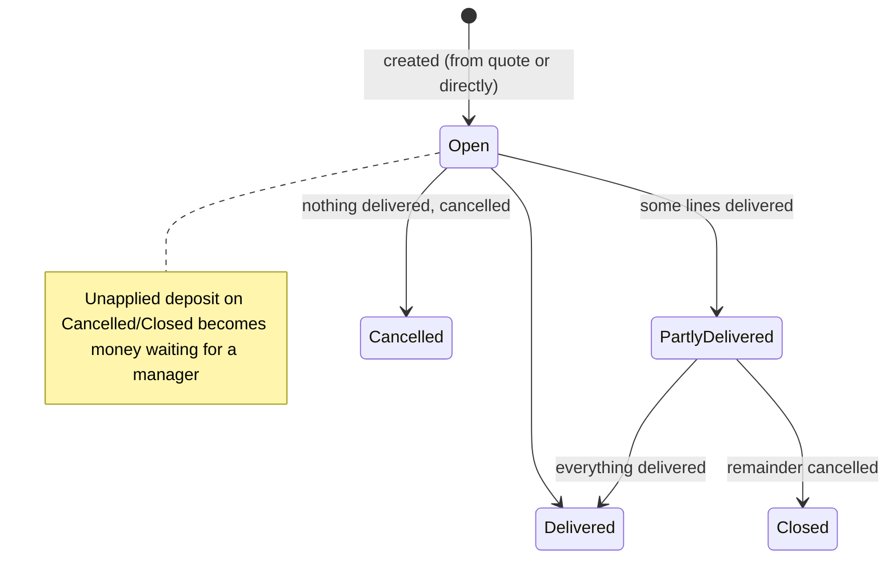
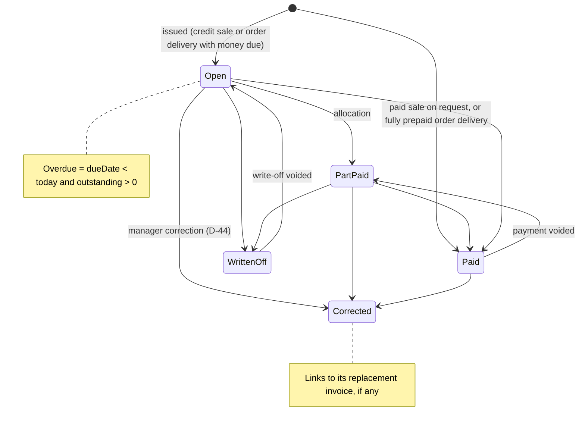

# UzaPay — Accounting, Quotations & Invoicing Discovery

**Status:** Discovery complete; specification agreed in interview; **not approved for implementation.**

**Revision 2 (2026-10-12).** Updated after a cross-check against a second, independent discovery (`ACCOUNTING_DISCOVERY_CROSSCHECK.md`). Changes:

- **New decisions:**
  - an order record between quote and sale, with a shortcut for quotes bought in full;
  - deposits belong to their order;
  - money beyond what is owed waits for a manager;
  - moving-average stock cost;
  - one tenant per shop;
  - bookkeeping in scope but built last.
- **Revised decisions:** D-03, D-05, D-08, D-11, D-14, D-15, D-16, D-19 and D-20.
- **Reconfirmed:** no credit limits (CF-1), and returns count when filed, on the original sale's day (D-28).
- **Corrected:** three code findings (D5, D6, R6).
- **Later the same day:** existing negative balances become waiting money; payment receipts numbered by the phone (D-40); default terms 7 days; returns switch to the day they happen when bookkeeping arrives (D-28 amended). No blocking questions remain. Quotes are built on their own screen, with a "Save as quote" shortcut on the Register (D-41); three new home icons (D-42); orders can start without a quote (D-43); the second review's held items settled (D-15 and D-29 confirmed, D-07 per-customer terms, D-44 to D-48).
- **Rewritten:** the roadmap.
- **Review fixes (2026-10-12, after an outside review):**
  - an invoice for every order delivery, showing total, paid and due (D-07);
  - account-level books start from opening balances (D-12, D-39);
  - corrections split into price, duplicate and genuine return, with no double stock deduction (D-44);
  - cost history: the till's estimate, the server's final cost, and the adjustment between them (D-37);
  - absorbing an over-delivery deducts no more stock (D-47);
  - a closed-month rule for late events (D-28);
  - replace or don't replace on returns against an order (D-49).

**Review date:** 2026-10-12. **Method:** source reading only. No tests were executed and no device or emulator runs were made.

---

## 1. Executive summary

**What exists.** `multitenant-main` has a sound, offline-first sales core:

- Every sale is one document in the business's own sales collection, and can never be changed after it is written.
- The till saves the sale and its stock decrements in one atomic write.
- Every sale is tied to a cashier's shift and a business date.
- Credit sales exist: a named customer can pay part with one method and owe the rest.
- Customer balances are moved only by the server, with a ledger per customer.
- Repayments are an idempotent callable, queued offline, and always go into the recorder's own shift.
- Returns can carry a refund. A manager verifies them, which restores stock and cancels the debt on that sale first.
- Shift reconciliation expects the right money in the drawer: what was paid on sales, minus credit, plus repayments, minus refunds.
- Reports show revenue and profit gross and net of returns, split by payment method.
- Receipts reach every printer, PDF, WhatsApp and email.

**What is missing.**

- No quotations, orders or invoices.
- No business-wide document numbering and no due dates.
- Payments cannot be allocated to sales.
- Payments cannot be voided and returns cannot be rejected.
- Money owed back to a customer cannot be paid out.
- Repayments produce no receipt.
- Reports have no "money collected" figure and no receivables ageing.
- There are no non-stock or service items.
- There is no tax, no bookkeeping, and only one payment method per sale.

**Agreed direction.** The existing sale stays the **only** event that books revenue and moves stock. Everything new is either a document with no financial effect, or a server-side ledger entry beside the existing customer balance:

- **Quotes** are offers. A quote bought in full in one go becomes a till sale directly.
- **Orders** record an accepted job when there is a deposit, a later delivery, or delivery in parts. An order fixes the agreed price and holds its own deposits.
- **Invoices** are numbered documents attached to the sales that create debt.
- **Repayments** settle debt, oldest due first. A deposit pays its own order's invoices first.
- **Money beyond what is owed is never spent automatically.** It waits for a manager to refund it or release it as credit.
- **Corrections** become possible: voids, payouts and write-offs.
- **Reports** separate revenue, money collected, money owed and money held.
- **Stock cost** becomes a moving average.
- **Shops** stay separate tenants.
- **Bookkeeping** (double entry and statements) is in scope but built last, on records designed to be posted.

---

## 2. Repository snapshot

| Item | Value |
|---|---|
| Repository | `bonnieace/flutterpos` |
| Branch | `multitenant-main` (verified; `main` is the older pre-multitenancy app) |
| Commit | `4a767dc28343dee717ca3688402665a1162d38fb` — "Release to Play even when the artifact copy cannot be stored", 2026-10-12 11:11 +0300 |
| Remote | `origin/multitenant-main` = same commit |
| Working tree | Uncommitted trading-day cutoff work in `lib/shift/**`, `lib/sales/**`, `lib/checkout/checkout_draft.dart` and `checkout_refusal.dart`. **Not reviewed.** |
| Reference repo | `bonnieace/pos` (Laravel). Skimmed for contrast only. |
| Second review | Another agent's discovery of the same commit; differences and rulings are in `ACCOUNTING_DISCOVERY_CROSSCHECK.md`. |

**Architecture relevant to this work.**

- **Client:** Flutter (Android and web). Sales go through an encrypted Hive outbox and are submitted as one Firestore batch. Other writes go through a durable queue of pending Cloud Functions calls.
- **Data:** everything lives under `tenants/{tenantId}/…`. Financial collections are server-write-only, with two exceptions: `sales` (the client creates them, and they are immutable) and `returns` (the client creates them as `pending`).
- **Server:** Cloud Functions v2 (callables, Firestore triggers, Cloud Tasks). The money arithmetic in `functions/src/operations/domain.ts` is mirrored on the device, and golden test vectors keep the two copies in step.
- **Roles and branches:** owner, admin, manager and cashier. There are no branches: one tenant is one shop.
- **Money:** integer minor units, with the currency stored on each sale.

---

## 3. Current-state audit

Status key: **Implemented**, **Partial**, **Missing**, **Legacy/inactive**, **Unverified**.

| Capability | Status | Evidence |
|---|---|---|
| Immutable, tenant-scoped sale with atomic stock decrement | Implemented | `checkout_sale.dart` (`toSubmission`), `checkout_submission.dart:138`, `firestore.rules:441-471` |
| Offline outbox, lease, hash-matched confirmation, recovery | Implemented | `checkout_outbox.dart`, `checkout_sync.dart`, `checkout_confirmation.dart:212`, `checkout_recovery.dart` |
| Payment method per sale: cash / M-Pesa / card / none (none can be filled in once later) | Implemented | `checkout_tender.dart`, `saleTender.ts` |
| Credit sale with part-pay (one method for the paid part) | Implemented | `checkout_sale.dart` (`CheckoutSaleCredit`), `checkout_cart_panel.dart:1077`, `firestore.rules:156` |
| Server-owned customer balance and ledger, idempotent per sale | Implemented | `customerSale.ts:172` (keyed on `activity/{saleId}`), `credit.ts` |
| Repayment: idempotent, queued offline, bound to the recorder's shift | Implemented | `payments.ts:108,183`, `customer_credit.dart`, `customer_payment_sheet.dart` |
| Returns with refund, manager verification, stock restore, debt cancelled first | Implemented | `firestore.rules:743-814`, `returns.ts`, `return_request.dart:83` |
| Shift drawer expectation including credit, repayments, refunds | Implemented | `reconciliation/model.ts:337,475,503`, `shift_sales_ledger.dart:160` |
| Revenue and profit gross/net of returns; split by method | Implemented | `domain.ts:514,666`, `salesSummaries.ts`, `processors.ts` |
| Sale stock movements written server-side | Implemented | `reconciliation/jobs.ts:571,656` (`registerSaleReceipt`) |
| Customer statement, "who owes" list, live total owed | Implemented (management only) | `customer_credit.dart`, `customer_directory_panel.dart:146` |
| Receipts with credit lines; WhatsApp/email auto-send for named customers | Implemented | `checkout_receipt_content.dart:226`, `whatsapp/receiptContent.ts`, `emailReceipts/` |
| Product cost | Implemented as **latest cost**: a delivery or production batch overwrites it; the till freezes it on each sale line | `supplierDeliveries.ts:36`, `production.ts` |
| Split payment across methods | Partial | One method plus credit only |
| Receivables reporting | Partial | Live total, silently capped at 500 debtors (see R6); no ageing |
| Payment evidence | Partial | Payment records exist; no receipt, no reference |
| Money owed to a customer (negative balance) | Partial | Allowed, spent automatically by the next credit sale; no payout |
| Corrections | Partial | Fill a missing method once; no payment void, no return reject, no sale void |
| Letterhead | Partial | Name, slogan and logo only |
| Quotes, orders, invoices, numbering, due dates, allocation, deposits, payouts, write-offs | **Missing** | — |
| Non-stock / open-price items | **Missing** | Every line must be a product; submission requires at least one decrement (`checkout_submission.dart:169`) |
| Money collected and ageing reports | **Missing** | Repayments appear only on shift cards |
| Tax / VAT / eTIMS; bookkeeping (accounts, journals, statements); supplier debt | **Missing** | The supplier report itself says "this app records no invoices or payments" (`supplier_report.dart:275`) |
| `lib/pos/**`, `lib/screens/**`, `lib/model/invoice.dart`, `lib/api/pdf_invoice_api.dart`, `lib/services/Receipt_service.dart` | **Legacy/inactive** | Listed unreachable in `test/dev/reachable_lib_test.dart` |
| Behaviour on a real device; whether the sales outbox wakes when a retry falls due | **Unverified** | Not run |

### 3.1 Scenario traces (current behaviour)

The labels show where each step runs: **C** = client, **S** = server, **R** = Firestore rules.

**Fully paid sale**
- *Path:* cart → draft → payload frozen and hashed into the outbox (**C**) → one batch writes the sale and a product decrement per line (**C**, checked by **R**) → the server writes stock movements and dirties the day, then projects daily totals (**S**).
- *Effects:* revenue is the total. The drawer expects the total under one method. No receivable. Stock goes down.

**Unpaid credit sale**
- *Path:* the same write, with `tender: "credit"`, a `cu_` customer and `creditOwedMinor` equal to the total. `processCustomerSale` then raises the balance in one transaction, keyed on `activity/{saleId}` (**S**). If the customer record has not synced, it retries for about a day.
- *Effects:* revenue is the total. Drawer: nothing. Receivable rises, possibly late.

**Partly paid credit sale**
- *Path:* the same, with a single paid method recorded.
- *Effects:* the drawer expects the paid part. The receivable rises by the owed part. The report shows the owed part as "Owed on credit".

**Repayment**
- *Path:* Customers → `recordCustomerPayment` (**S**). It checks the shift belongs to the caller, writes the payment and its ledger entry, and lowers the balance, which can go below zero.
- *Effects:* no revenue. The recorder's drawer rises. The receivable falls.

**Several repayments**
- Each has its own ID and ledger entry. None is linked to a sale.

**Return**
- *Path:* the client creates a `pending` return, pinned to the sale's business date, with an optional refund out of the recorder's own shift. A manager verifies it, which restores stock and cancels debt on that sale first.
- *Effects:* revenue is netted at filing, on the sale's day. The refund leaves the drawer on the refund date. Debt and stock change only at verification.

**Cancelled or failed sale**
- A save is all-or-nothing. A refused batch waits for a confirmation read. There is no void of a committed sale.

**Offline sale**
- The payload is frozen and hashed locally, and the receipt number comes from the device's own counter. The credit balance moves later, on the server.

**Duplicate retry**
- The sale path is deterministic; a second write to it is an update, which the rules deny. Confirmation matches on the payload hash. Payments and customer counts are idempotent.

**Two cashiers**
- Stock increments are never lost, but stock can go negative, and reconciliation flags it. Balances move inside transactions. Two offline repayments of the same debt both land, so the customer ends up overpaid.

**Switching tenants**
- Outbox records are keyed to the user and the tenant, and are refused under another session. The session epoch is re-checked during sync, writes are confined to the tenant, the rules check `activeStaff(tenantId)`, and callables check membership.

**Shift close**
- A shift cannot close while any of its sales are unconfirmed. The drawer equation is: sales, minus credit, plus repayments, minus refunds.

---

## 4. Transaction behaviour — current vs proposed

**Current (confirmed)**

| Event | Revenue | Money collected | Customer receivable | Inventory |
|---|---|---|---|---|
| Cash / M-Pesa / card sale | +total (sale day) | +total in seller's shift | — | −qty |
| Credit sale, unpaid / part paid | +total | +paid part | +owed (server task) | −qty |
| Repayment | — | +amount | −amount (may go below 0) | — |
| Return, pending | netted on the sale's day | −refund in the refunder's shift | unchanged | unchanged |
| Return, verified | (already netted) | — | −debt on that sale | +qty |
| Quote / order / invoice / deposit / payout / write-off / void | does not exist | | | |

**Proposed (agreed)**

| Event | Revenue | Money collected | Debt / money held | Inventory |
|---|---|---|---|---|
| Quote (any revision) | — | — | — | — (open quantities shown) |
| Quote bought in full in one go | normal till sale at the quoted price (until expiry) | as today | as today | −qty for stocked lines |
| Quote accepted for a deposit, later delivery or delivery in parts → **order** | — | — | — | — |
| Deposit on an order | — | +amount in recorder's shift | held **on the order** (not customer debt) | — |
| Delivery from an order | +delivered value at the order's fixed price | paid now, if anything | **invoice always** (total, paid, due); the order's deposit applied first | −qty for stocked lines |
| Credit sale (money left owing) | +total | paid part | +owed; **invoice issued automatically** (total, paid, due) | −qty |
| Repayment | — | +amount | debt −amount, oldest due first (pre-invoicing balance first) or to a chosen invoice; **any excess waits for a manager** | — |
| Manager releases waiting money as credit | — | — | waiting → released credit, spendable via "Use money on account" | — |
| Manager refunds waiting money or credit (payout) | — | −amount in manager's shift | held money −amount | — |
| Order cancelled (remainder) | — (or a fee sale if part is kept) | — | the unapplied deposit becomes money waiting for a manager | — |
| Payment void (manager) | — | the original shift's expectation is reversed | debt and allocations reversed | — |
| Return rejected (manager) | the netting is undone | the refund expectation is undone (unless the refund really happened) | — | — |
| Write-off (owner/admin) | unchanged | — | debt −amount, reported as "Written off" | — |
| Split payment at the till | +total | +amount per method | as today | as today |

---

## 5. Verified defects and technical risks

**D1 — Medium — A repaid credit sale that is later returned strands the customer's money.**
- *Evidence:*
  - `returnedShare` (`customerSale.ts:455`) ignores repayments.
  - The refund limit is what was paid at the counter (`return_request.dart:83`).
  - Nothing pays out a negative balance.
- *Reproduction:* a KES 10,000 credit sale, a 10,000 repayment, a full return, then verification. The balance ends at −10,000 with no way to pay it out.
- *Remedy (now agreed):* anything beyond what is owed becomes money waiting for a manager, who refunds it or releases it as credit (D-36, Phase A).

**D2 — Medium-High — Payments and returns entered in error cannot be undone.**
- *Evidence:* the only payment callable creates payments; returns allow no client update (`returns.ts:263`).
- *Remedy:* voids and rejections (D-09, Phase A).

**D3 — Low — The "Owed on credit" row reads as receivables.**
- *Evidence:* `sales_report_panel.dart:2221`.
- *Remedy:* rename it "Sold on credit" and add "Owed now".

**D4 — Low — The rules cap a refund at the sale total, not at what was paid.**
- *Evidence:* `firestore.rules:792`.
- *Remedy:* cap it at `totalMinor − creditOwedMinor`.

**D5 — Low–Medium — The rules accept a part-paid credit sale with no paid method.** (Found by the second review.)
- *Evidence:* `firestore.rules:169-170` allow a missing `creditPaidTender`. `credit.ts:77` then reads the sale as not credit, so no debt is charged and the whole total is expected in the drawer as unattributed.
- *Reach:* the app cannot produce such a sale (`checkout_cart_panel.dart:3623`, `checkout_sale.dart:159`); only a modified client can.
- *Remedy:* require `creditPaidTender` whenever `creditOwedMinor < totalMinor`.

**D6 — Medium — Any active staff member can lower stock with no sale.** (Found by the second review.)
- *Evidence:* `firestore.rules:368-371` keep a branch for builds older than `lastSaleId`, which allows a quantity decrease on `activeStaff` alone.
- *Mitigation today:* reconciliation reports the shortage.
- *Remedy:* retire the branch once no installed build relies on it; that needs the build versions in use (open question 12).

**R1 — Design risk — Sale amounts are asserted by the client.**
- The rules do not check that the total adds up or that prices match the catalog. This is deliberate (the haggling ruling).

**R2 — Design risk — Customer balances can lag.**
- They move in a task that can retry for about a day. Invoices issued from that task will lag the same way.

**R3 — Design risk — Pending returns move revenue before debt.**
- Revenue is netted when a return is filed, but debt is cancelled only when it is verified (kept by D-28).

**R4 — Design risk — Returns restate past days.**
- Kept by D-28 until Phase I. From then on, returns lower the day they happen, so closed periods stay closed.

**R5 — Design risk — Receipt numbers are per device per day.**
- They cannot serve as a business-wide series, hence server numbering.

**R6 — Low — The owing list stops silently at 500 customers.** (Confirmed by the second review.)
- *Evidence:* `loadOwing` returns a plain list and stops after 10 pages of 50 with no completeness marker, so the Customers total understates.
- *Remedy:* page completely on the server, or report the total as incomplete.

---

## 6. Decisions from the interview

All were made by the developer on 2026-10-12 and are **confirmed**. "Rec" is the option I recommended. **(rev 2)** marks decisions added or changed after the cross-check.

### Rulings carried forward from 2026-10-01/02, and reconfirmed

- **CF-1** **No credit limits.** A manager blocks a customer instead. *Reconfirmed in rev 2, rejecting the second review's limits and manager approvals.*
- **CF-2** Part-pay at the till.
- **CF-3** Credit sales allowed offline.
- **CF-4** Any cashier takes repayments, from Customers, into their own shift. Deposits are also taken on orders.
- **CF-5** Balance on the receipt; statement and "who owes" list.
- **CF-6** Reminders: automatic reminders stay out; a manual reminder is in (D-26).
- **CF-7** Agreed prices are limited to the per-person allow list. *Exception:* quote and order prices apply for anyone (D-08).

### Decisions

**D-01 Target users.** Regulars on account; quote-then-sell; made-to-order with deposit. **Not** business customers on payment terms.

**D-02 What an invoice is.** A numbered document attached to the till sale that created the debt. The sale remains the only event for revenue and stock. Pre-delivery paperwork is a quote; an accepted job becomes an order (D-34). Rec same.

**D-03 Applying payments (rev 2).** The customer balance (`balanceMinor`) stays authoritative for **debt**, and the server records allocations. The order of application:
1. A deposit goes to its own order's invoices, first invoice first (D-35).
2. A repayment goes to the invoice the cashier chose; otherwise to the pre-invoicing balance, then to invoices oldest due first.
3. **Anything beyond what is owed is not applied automatically.** It waits for a manager (D-36).

**D-04 Tax and eTIMS.** eTIMS later, with room left. VAT accounts arrive with bookkeeping (D-39). No document is titled "Tax invoice". Obligations must be confirmed with a tax adviser.

**D-05 Deposits (rev 2).** A deposit is a payment of kind `deposit` linked to an **order**.
- It counts in the recorder's shift like any payment.
- It is held on the order, and is not customer debt or general credit.
- Each delivery's invoice uses it automatically.

**D-06 One-off and service items.** A product flag `stocked: false`. The price is typed per quote, order or sale, and the line may carry its own description. Such lines never decrement stock.

**D-07 When an invoice is issued (amended).** Decided from the sale record alone, never from which record reached the server first:
- **Every delivery from an order** gets an invoice, even when the deposit covers it all; it then shows Paid.
- **A credit sale** (money left owing) gets one.
- **A paid till sale** gets one only on request.
- **Every invoice shows three figures:** total, already paid (deposit, paid at the till, credit used) and due. A deposit or payment that lands later is applied to it and lowers what is due.

The due date comes from the business's default terms, which start at **7 days** and can be changed in Configs; managers can edit an invoice's due date. **Per-customer terms (added 2026-10-12, cross-check C10):** a manager can give a customer their own default, which overrides the business's.

**D-08 Prices (rev 2).**
- **A quote bought in full in one go:** the quoted price is honoured until expiry. The difference from catalog is recorded as the sale's agreed-price discount, with reason `Quote QT-…`, allowed for anyone. After expiry, current prices apply.
- **An order fixes its price at acceptance,** and every delivery charges the order's price, however late.
- If the catalog price has since fallen, the customer pays the lower current price, because a sale can only record a reduction.

**D-09 Undo.** Owner, admin or manager can void a payment or reject a pending return, with a reason.
- A reversing entry restores the balance and allocations, and corrects the original shift's expectation; that day is re-reconciled.
- The original record stays visible, marked void.

**D-10 Numbering.** Server-assigned series for quotes, orders and invoices (`QT-`, `OR-`, `INV-`), issued on sync. Offline quotes print "Draft – not yet numbered". Payment receipts are numbered by the phone instead (D-40), because they must print at the counter.

**D-11 Report figures (rev 2).**
- **Money collected:** paid at the counter + repayments + deposits − refunds − payouts, by method.
- **Owed now,** with ageing by due date: not yet due, 1–30, 31–60, 61–90, 90+, plus "Before invoicing".
- **Money held:** deposits on open orders, money waiting for a manager, and released credit, each shown separately.

**D-12 What a payment records.** Cash, M-Pesa or card, plus an optional reference (an M-Pesa code or bank slip number). Bank as a payment destination arrives with money accounts in the bookkeeping phase (D-39). **Which account** received the money (one of two M-Pesa tills, say) is not recorded before Phase I; account-level books start from opening balances then (D-39).

**D-13 The report label.** "Owed on credit" becomes **"Sold on credit"**. It excludes the parts paid from a deposit or credit.

**D-14 Using credit at the till (rev 2).** "Use money on account" spends **released credit** only (D-36). An order's deposit is applied automatically on delivery, without the cashier choosing. The receipt shows "Deposit applied" and "From account" separately. The part covered by a deposit is allowed even for a customer whose credit is blocked, because it is the customer's own money.

**D-15 A cancelled order (rev 2).**
- The undelivered remainder is closed.
- The unapplied deposit becomes money waiting for a manager, who refunds it, releases it as credit, or keeps part as a not-stocked "Cancellation fee" sale.
- **Confirmed 2026-10-12** over the second review's objection (cross-check C3): keeping part is allowed.

**D-16 Who a quote is for (rev 2).** A quote can carry just a typed name and phone. A customer record is created, or matched by phone, when an order is created or a credit sale needs one.

**D-17 Editing a sent quote.** A new revision under the same number; earlier revisions are frozen. Only the latest revision can be accepted.

**D-18 Quote expiry.** Typed on every quote, required, with no business default. Expiry limits **acceptance**; once an order exists, its price holds (D-08).

**D-19 Delivery in parts (rev 2).** Tracked on the **order**: ordered, delivered and cancelled per line ("3 of 6 delivered"). Each delivery is a normal sale. A delivery that leaves debt gets its own invoice.

**D-20 Stock reservation (rev 2).** None. Management sees quantities on open quotes and orders beside stock. Stock never blocks a sale.

**D-21 Letterhead.** Phone and address, the business's KRA PIN (display only), payment instructions (paybill, till, bank) and terms text, with an optional signature line.

**D-22 Channels.** A4 PDF, WhatsApp and email for quotes, orders, invoices and payment receipts. Each WhatsApp document type needs a Meta-approved template.

**D-23 Thermal printing.** Payment receipts also print on the till's printer.

**D-24 Payment receipts.** A payment receipt for every repayment, deposit and payout. It is printed on request, and sent automatically where the customer has WhatsApp or email turned on. Numbered per D-40.

**D-25 Roles.**
- **Any staff:** quotes, orders, deliveries, payments and deposits.
- **Manager and above:** voids, return rejections, payouts, releasing waiting money, due-date changes, and cancelling others' quotes or orders.
- **Owner or admin:** write-offs.

**D-26 Overdue.** Shown on lists and in ageing. A warning at the till never blocks (CF-1). A manual "Send reminder" is available.

**D-27 Write-off.** Owner or admin, with a reason. It lowers debt, is reported as "Written off", leaves revenue unchanged, and can be voided.

**D-28 Returns (reconfirmed in rev 2, amended 2026-10-12).** A return counts **when filed**, as today. It is not deferred to approval; the second review's "on approval" was rejected.
- **Until bookkeeping (Phase I):** a return lowers **the original sale's day**, as today.
- **From Phase I:** returns lower **the day they happen**, everywhere: reports, daily figures and books alike. Past and closed days then stop changing.
- **Closed months (from Phase I):**
  - every return keeps the date it happened;
  - if that month is already closed, it is recorded in the current open month;
  - a rejection or a void is a reversing entry in the open month;
  - a closed month is never changed.

  The same rule applies to cost adjustments (D-37) and any other event that arrives late.
- **Cost:** this changes the return arithmetic on both server and device, the shared vectors, the daily metrics, and the rule that pins a return's date to its sale's. The work belongs to Phase I.

**D-29 Split payments.** At the till, as their own phase after invoicing. Installed builds show a split sale as "Not recorded", and its total stays correct. **Confirmed 2026-10-12** (cross-check C6): till only. Repayments and deposits stay one method each, and several payments cover a split.

**D-30 Existing debt.** Invoices start from go-live, with no backfill. The balance at go-live is a "Before invoicing" bucket and is settled first by repayments.

**D-31 Compatibility.** Additive only, so installed builds keep working. They will not show new statement entries, but balances come from the server.

**D-32 Cost on custom lines.** Optional, typed in, and visible only to roles that see profit. A blank cost means profit for that line is withheld.

**D-33 Reminders.** Sent by manager and above.

**D-34 Orders (new, rev 2).**
- **When an order is created:** accepting a quote creates one when there is a deposit, a later delivery, or delivery in parts. A quote bought in full in one go becomes a till sale directly, with no order.
- **Rec:** an order fixes the price, holds deposits, and tracks what has been delivered and what remains.

**D-35 Deposits belong to their order (new, rev 2).** A deposit pays that order's invoices automatically, first invoice first. It never pays the customer's other or older debt.

**D-36 Money beyond what is owed waits for a manager (new, rev 2).**
- **What it covers:** an overpaid repayment, a return on an already-paid sale, a duplicate offline payment, or the leftover deposit of a cancelled order.
- **What happens:** it waits as "money waiting for a decision" and never reduces a later sale automatically.
- **The manager's choices:** refund it (a payout) or release it as credit. Released credit is spent through "Use money on account".
- **Why:** it closes the hole where a duplicate payment became spendable before anyone reviewed it.

**D-37 Stock cost: moving average, with history (new, rev 2; amended).**
- **How the average moves:** when stock arrives (a supplier delivery or a production batch), the server sets the product's cost to the weighted average of the stock on hand and the stock received. If stock on hand is zero or negative, the cost is simply the new cost. Every change is kept in a dated cost history for the product.
- **Three costs per sold line, nothing overwritten:**
  - the till's recorded cost, its estimate, kept unchanged on the sale;
  - the server's **final cost**;
  - the **adjustment** between the two, kept as its own record.
- **Which average a sale gets:** the average in effect when the sale was rung up. The ring-up time comes from the phone's clock, held between the shift's opening and the sale's arrival at the server, so a wrong clock cannot pick an absurd average. A sale that syncs late still gets the average from when it was rung up.
- **Late events:** events are ordered by when they happened, not when they synced. A late delivery, or a cost entered late, recomputes the average forward from its time, and the affected sales get new adjustments. The recompute runs as a bounded server job; anything beyond the bound is flagged rather than guessed.
- **Delivery with no cost:** the product's cost becomes **unknown** until the price is entered. Final costs for lines sold meanwhile stay pending, and their profit is shown as incomplete, never quietly guessed.
- **Profit:** reports add each day's adjustments to the profit worked out from the till's costs, so the existing profit arithmetic is not rewritten. Phones offline show provisional profit, labelled as such.
- **Closed months (from Phase I):** an adjustment that belongs to a closed month is posted in the current open month (D-28). Before Phase I there are no closed months, so adjustments simply update that day's profit.
- **Rejected:** FIFO, unless an accountant requires it, because it conflicts with negative stock and late offline sales.
- **Was:** latest cost, which overwrites the cost on every delivery.

**D-38 Shops stay separate (new, rev 2).**
- **Rule:** one tenant per shop. No parent business and no shared books.
- **Optional later:** a combined report for owners across the shops they own.
- **What this means:** a customer's debt and the stock stay with their own shop.

**D-39 Bookkeeping: in scope, built last (new, rev 2).**
- **Order:** corrections → quotes and orders → invoices and allocation → supplier debt (single-entry, built like customer credit) → double entry.
- **Double entry covers:** a chart of accounts, opening balances, journals posted from existing records, and financial statements. Money accounts (including bank), VAT accounts and fixed assets come with it.
- **Every earlier phase is built to be posted:**
  - no edits, only reversing records;
  - the payment method is recorded on every payment, and an expense records what paid it. **Which account** received the money is not recorded, so account-level books start from **approved, reconciled opening balances** in Phase I, and earlier account history is **not rebuilt**;
  - the date something happened is kept apart from the business day it counts on;
  - records are linked to each other;
  - deposits, waiting money, credit and debt are kept as separate figures.

**D-40 Payment receipt numbers (new, 2026-10-12).**
- **Format:** numbered by the phone, the same way sales are, so it works offline: `PY-<phone code>-<trading day>-<sequence>`, e.g. `PY-7F2-20261012-0003`, printed `JOHN-PY-7F2-003`.
- **Counter:** its own per phone per trading day, separate from sales. Sale numbers keep running with no gaps, and the sales rules (`CT-` only) are untouched.
- **Shared:** one counter for repayments, deposits and payouts. The slip's title says which ("Payment received", "Deposit received", "Refund paid").
- **Date:** the date in the number is the shift's trading day, not the clock.
- **Online or offline:** the number never depends on the connection; it is the phone's number either way.
- Rec same.

**D-41 Where quotes are built (new, 2026-10-12).**
- **The quote screen is the main place.** It uses the same product search component as the till, and works **without an open shift** (for example, an owner answering a WhatsApp enquiry at home). It is also where custom lines, the customer, the expiry date, terms, sending and revisions are handled.
- **The Register gets a "Save as quote" shortcut** for a customer at the counter. The cart empties into a new quote and the quote screen opens to finish it. Nothing is sold, no stock moves, and nothing enters the sales outbox; the quote goes through the pending-mutation queue.
- **Editing an existing quote happens only on the quote screen,** never by loading it back into the Register, so selling and quoting stay separate at the till.
- Rec same.

**D-42 Navigation (new, 2026-10-12).** Three new home icons in the Sales group: **Quotes**, **Orders** and **Invoices**. Every other new screen goes inside an existing icon:
- **Register:** load a quote or order, Save as quote, custom lines, Use money on account.
- **Customers:** an Invoices tab, money held, refund or release, void, write-off.
- **Reports:** money collected, owed now with ageing, money held, written off.
- **Suppliers:** bills and supplier debt (Phase H).
- **Returns:** reject a return.
- **Inventory:** the "Not stocked" switch.
- **Configs:** invoicing settings and letterhead.

A fourth icon, **Books**, arrives with bookkeeping (Phase I).

**D-43 Orders without a quote (new, 2026-10-12).** An order can be started directly from the Orders icon, for example a job phoned in with a deposit. It follows the same rules as an order created from a quote: a customer record, a fixed price, deposits held on the order, and delivery in parts.

*D-44 to D-48 settle the items held from the second review (cross-check C9, C13; B's D23, D27, D51), all on 2026-10-12.*

**D-44 Correcting an issued invoice (new, amended).** A manager corrects an invoice with a reason, linked to the original. The original sale is never edited, and stock moves only when it really should:
- **Wrong price:** fix the difference only.
  - Lowering it is a correction (`kind: correction`, `reason: price`) with no stock movement.
  - Raising it is a sale of a not-stocked "Price adjustment" line, also with no stock movement.
  - No replacement sale is made.
- **Goods came back:** a normal return. Stock goes back for what physically returned (D-45).
- **Recorded twice, left once:** a correction (`reason: duplicate`) that cancels the duplicate's charge and **reverses its stock deduction**, even though nothing came back. This is not a return.
- **A replacement sale is allowed only when goods really leave the shop again.**
- **How it behaves:** it follows D-28 like any return. Payments already applied stay real, and any excess goes to money waiting for a manager (D-36).

**D-45 Condition of returned goods (new).** At verification, a manager marks each returned line **sellable** or **damaged**.
- **Sellable:** restores stock, as today.
- **Damaged:** restores stock and records a `damage` stock adjustment in the same transaction. This reuses the existing adjustment type, so the loss shows in stock and loss reports, and damaged goods never count as sellable stock.

**D-46 When service revenue counts (new).** No change: revenue counts when the sale is rung up. Staff ring up a service when the work is completed, or as an order delivery (D-19) for staged work.

**D-47 Delivering more than was ordered (new, amended).** Both sales stand and the system flags the over-delivery. Stock has already dropped for everything that left. A manager decides, with a reason recorded on the flag:
- **Charge for it:** the sale stands; nothing more to do.
- **Get it back:** a return of the extra.
  - The returned goods' condition is recorded as usual (D-45), and stock goes back up.
  - The charge comes off what is owed, or becomes money waiting for a manager if it was already paid (D-36).
  - The order shows the ordered quantity delivered.
- **Absorb it:** cancel the charge for the extra with a correction (`reason: overDelivery`, no restock), and record its cost as a loss. **Stock is not reduced again.**

**D-48 Not enough stock for an order (new).** Partial delivery (D-19) covers it: deliver what is there and leave the rest open, or cancel it. Stock never blocks a sale, and there is no hard cap at fulfilment, because a cap cannot be enforced offline.

**D-49 Returns against an order delivery (new).** When a returned line came from an order delivery, the manager chooses at verification:
- **Replace it:** the order line reopens (delivered goes down by the quantity returned), to be delivered again.
- **Don't replace:** the order stays as it is, and the invoice is reduced by the returned value.
- **An over-delivery return skips the choice:** the extra is never redelivered (D-47).

---

## 7. Outstanding questions

**Resolved in rev 2:**
- Question 1 (refunding a return on an already-paid sale) is settled by D-36. The counter refund is still capped at what was paid at the sale; the rest waits for a manager.
- Question 5 (an "accepted" step) is settled by D-34. Accepting either creates an order or completes a direct sale.

**Blocking — must be answered before the phase named.**

1. ~~**(Phase A) Existing negative balances at go-live.**~~ **Resolved 2026-10-12: they become money waiting for a manager's decision** (consistent with D-36).
2. ~~**(Phase A) Numbering payment receipts taken offline.**~~ **Resolved 2026-10-12:** numbered by the phone with its own counter, `PY-<phone>-<trading day>-<seq>`, printed `JOHN-PY-7F2-003` (D-40).
3. ~~**(Phase E) Default payment term.**~~ **Resolved 2026-10-12: 7 days**, editable per business (D-07).
4. ~~**(Phase I) Returns versus locked periods.**~~ **Resolved 2026-10-12:** when bookkeeping arrives, returns switch to the day they happen, everywhere (D-28).

**Non-blocking.**

5. Should invoices be sent automatically when issued (recommended), or only on request? The second review recommended the opposite.
6. Should a return on an invoiced sale print as a credit note? (Optional.)
7. ~~Navigation.~~ **Resolved 2026-10-12** (D-42).
8. Matching a typed phone to an existing customer: the app suggests the match and the cashier confirms.
9. ~~Delivering more than ordered.~~ **Resolved 2026-10-12** (D-47).
10. A payout requires the manager's own open shift.
11. WhatsApp cost: who pays, and are there per-business limits?
12. Which app builds are still installed? This decides when the older stock-decrement rule (D6) can be retired.
13. Who can change an order's price after acceptance? The recommendation: manager and above, with a reason.
14. ~~Orders without a quote.~~ **Resolved 2026-10-12: yes** (D-43).
15. Should released credit be used only at the till ("Use money on account"), or can a manager also apply it to an open invoice? The recommendation: both.
16. Phase order between split payments (G) and supplier debt (H). The recommendation: as listed; either can go first.
17. ~~Items held from the second review.~~ **Resolved 2026-10-12:** keeping part of a deposit is allowed (D-15); split payments at the till only (D-29); invoice correction (D-44); per-customer terms (D-07); returned-goods condition (D-45); service revenue unchanged (D-46); over-delivery outcome (D-47); short stock (D-48). Choosing a money account on every payment, and the second review's bookkeeping details, come with Phase I.
18. Confirming VAT and eTIMS obligations with a tax adviser.
19. Export of invoices and payments for an accountant before bookkeeping exists.

---

## 8. Proposed workflows

### 8.1 Quote → order or sale → invoice → payment

### 8.2 Quote states

### 8.3 Order states

### 8.4 Invoice states

An invoice is attached to a sale, so it is never edited. Corrections go through a return, a correction (D-44) or a write-off. A correction can link a replacement invoice.

### 8.5 Step-by-step

**Cash sale.** Unchanged. Not-stocked lines skip the stock decrement.

**Credit sale**
1. The cashier chooses a customer and selects "Put on credit", optionally paying part now. If the customer has released credit, the till offers "Use money on account".
2. The server raises the balance and issues the invoice in the same step, showing total, paid and due.

**Order with deposit (the sofa)**
1. The quote is accepted. An order is created with price KES 25,000.
2. A deposit of 10,000 is taken by M-Pesa. Monday's drawer gets +10,000, and the order holds 10,000.
3. On delivery, the till is prefilled from the order and shows "Deposit 10,000". The customer pays 0 now; the rest goes on account.
4. The sale is 25,000, and INV-… is issued: **Total 25,000 · Paid 10,000 (deposit) · Due 15,000**. Stock goes down by one.
5. Friday's repayment of 15,000 marks the invoice Paid.

**Partial delivery (six chairs)**
1. An order for 6 × 4,000 with a deposit of 8,000.
2. Week 1: deliver 3. INV-A: Total 12,000 · Paid 8,000 (deposit) · Due 4,000.
3. Week 2: deliver 3. INV-B: Total 12,000 · Paid 0 · Due 12,000.

**Fully prepaid delivery.** Wanjiru paid all 25,000 upfront. On delivery, INV-… shows Total 25,000 · Paid 25,000 · Due 0, and is marked Paid. The invoice is the same whether the deposit reached the server before the sale or after it.

**Repayment.** Applied to the chosen invoice, else to the pre-invoicing balance and then oldest due. Any excess becomes money waiting for a manager.

**Return and refund**
1. Filed as today; revenue is netted on the sale's day. The counter refund is capped at what was paid at the sale.
2. A manager verifies it: stock is restored, and the outstanding amount on that sale's invoice is cancelled first. Anything beyond goes to money waiting for a manager.
3. A pending return filed in error can be rejected. If its refund really was handed over, the manager keeps the refund and re-files the return against the right sale.

**Cancelled order.** The undelivered remainder is closed, and the unapplied deposit waits for a manager: refund, credit, or a fee sale.

**Offline and failure recovery**
- Quotes and orders are queued with IDs minted on the device and numbered on sync.
- Payments are queued as today; allocation happens on the server.
- Invoices are issued only by the server and are idempotent per sale.
- A duplicate offline payment becomes money waiting for a manager.
- Over-delivery is flagged as an anomaly.
- Records waiting to sync use the existing queue states.

---

## 9. Proposed data model

**Authoritative sources**

| Concept | Authority |
|---|---|
| Revenue | `sales`, netted by `returns` (unchanged) |
| Inventory quantity | `products.quantity` + `stock_movements` (unchanged) |
| Inventory cost | `products` cost (a **moving average**) with a dated `cost_history`. Each sold line's final cost and adjustment live in `sale_cost_adjustments`; the till's frozen cost stays on the sale as its estimate (D-37) |
| Customer debt | `customers.balanceMinor`, server-only, never below 0 after go-live; explained by `activity` |
| Money held for a customer | order deposits not yet applied (`orders`), money waiting for a manager and released credit (`customers`), each explained by `activity` |
| Money collected | Paid part of sales + `customer_payments` (repayments, deposits) − refunds − payouts, net of voids |

**Reused, additive fields only**

- **`sales`** (schema stays 2):
  - `quoteId` / `quoteRevision` for a direct sale, or `orderId` for a delivery
  - `creditFromAccountMinor` (the till's claim of credit used) and `depositAppliedMinor` (the till's estimate)
  - per line: `stocked: false`, `description`, a typed price and optional cost
  - last phase: `paymentsMinor {cash?, mpesa?, card?}`
- **`products`:** `stocked: false`, `openPrice: true`; the cost is now a moving average.
- **`customer_payments`:**
  - `kind: repayment | deposit` (absent means repayment)
  - `orderId`, `reference`, `targetInvoiceId`
  - void fields, and a receipt number
- **`customers`:**
  - `waitingMinor` (money waiting for a manager) and `creditMinor` (released, spendable)
  - `holdsMoney` (a queryable flag)
  - `preInvoicingOutstandingMinor`, `invoicingStartedAt`
  - `oldestOpenDueDate` and a small `openDueSchedule`, so the till can warn about overdue offline
  - `paymentTermsDays` (optional; overrides the business default, D-07)
- **`customers/{id}/activity`:** new kinds `deposit`, `deposit_applied`, `excess`, `release`, `payout`, `writeoff`, `void`. Old builds skip unknown kinds.
- **`returns`:**
  - `status: rejected` with who, when and why. Netting must exclude rejected returns on both server and device, and the shared vectors must be extended.
  - `kind: return | correction` (absent means return)
  - on a correction: `reason: price | duplicate | overDelivery`, and `restock` (true only for a duplicate)
  - `replacesInvoiceId` / `replacementSaleId`, only when goods leave again (D-44, D-47)
  - `replaceDecision: replace | keep` on a line from an order delivery (D-49)
  - per line, `condition: sellable | damaged`, set at verification (D-45)
- **Branding:** phone, address, business KRA PIN, payment instructions and terms text.
- **`configuration/invoicing`:** `{defaultTermsDays (starts at 7), goLiveAt, enabled}`.
- **`customer_payments` / `customer_payouts`:** `receiptNumber` in the `PY-<phone>-<trading day>-<seq>` shape, minted on the phone (D-40).
- **Expenses:** an optional `paidWith` (cash, M-Pesa, card), for posting later (D-39).

**New, all server-write-only**

| Path | Purpose | Key fields |
|---|---|---|
| `quotes/{qt_…}` | Offer | `number`, `status`, `revision`, `validUntil`, typed or linked customer, lines (`stocked`, `description`, prices, optional cost), totals, `termsText`, `sentVia[]`, `orderId?` / `saleId?` (outcome), reserved tax fields |
| `quotes/{id}/revisions/{n}` | Frozen copy of each version sent | lines, totals, `validUntil`, `sentAt` |
| `orders/{or_…}` | Accepted job | `number`, `quoteId?`, `customerId` (required), lines `{ordered, delivered, cancelled, unitPriceMinor fixed}`, `status`, `depositHeldMinor`, `depositAppliedMinor`, `createdBy`, `priceChanges[]` (who, why) |
| `orders/{id}/deliveries/{saleId}` | Idempotent record of each delivery | lines and quantities, `depositAppliedMinor`, `overDelivered?` |
| `invoices/{saleId}` | One per order delivery, per credit sale, or per paid sale on request | `number`, `saleId`, `orderId?`, customer snapshot, `issueDate`, `dueDate`, `totalMinor`, `paidAtSaleMinor`, `depositAppliedMinor`, `creditUsedMinor`, `chargedMinor`, `allocatedMinor`, `returnedMinor`, `writtenOffMinor`, `outstandingMinor`, `status`, reserved tax/eTIMS fields |
| `allocations/{id}` | Which money settled which invoice | `customerId`, `sourceType: deposit\|payment\|credit\|return\|writeoff\|void`, `sourceId`, `invoiceId \| pre_invoicing`, `amountMinor`, `reversedBy?` |
| `customer_payouts/{id}` | Money handed back (a separate collection so installed builds' shift sums are not inflated) | `customerId`, `amountMinor`, `tender`, `reference`, `shiftId`, `businessDate`, `recordedBy`, `source: waiting\|credit`, void fields |
| `customer_writeoffs/{id}` | Bad debt | `customerId`, `amountMinor`, `reason`, `businessDate`, `recordedBy`, void fields |
| `counters/{quotes\|orders\|invoices}` | Business-wide sequences | `next` |
| `products/{id}/cost_history/{id}` | Dated changes to the average cost | `effectiveAt`, `averageMinor` or `unknown`, `quantityOnHand`, `sourceType`, `sourceId` |
| `sale_cost_adjustments/{saleId}` | Final cost per sold line, and its adjustment against the till's cost | lines `{productId, tillUnitCostMinor, finalUnitCostMinor or pending, adjustmentMinor}`, `ringUpAt`, `businessDate`, `postedPeriod?` |

**Invariants (checked by reconciliation)**

1. `balanceMinor` = `preInvoicingOutstandingMinor` + the sum of open invoices' `outstandingMinor`, and is never below 0.
2. For each invoice, `outstanding = charged − allocated − returned − writtenOff`, and is at least 0.
3. For each order, deposits taken = `depositHeldMinor` + `depositAppliedMinor` + whatever was moved to waiting money on cancellation.
4. Customer money held = `waitingMinor` + `creditMinor` + the sum of open orders' `depositHeldMinor`. Every movement has an activity entry.
5. One invoice per sale, one delivery record per sale, and one conversion per quote.
6. No stock decrement for a `stocked: false` product. Reconciliation compares each line's flag with the product's flag.
7. Each sold line's final cost equals the average in its product's cost history at the line's ring-up time, or is pending while that cost is unknown.
8. No correction or recovery reduces stock that has already left: stock is reduced at most once per item physically handed over.

**Ownership:** every path is under `tenants/{tenantId}`, with `tenantId` repeated in each document and checked by every callable. One tenant is one shop (D-38).

---

## 10. UI/UX changes

**Mandatory**

- **Quotes** (Sales):
  - list, editor (catalog search shared with the till, plus custom lines; typed name and phone; required expiry; works without an open shift) and revisions (D-41)
  - send by PDF, WhatsApp or email
  - **Sell now** (straight to the till) or **Accept as order**
- **Orders** (Sales):
  - list and detail: ordered, delivered and remaining per line; deposits held and applied
  - take a deposit
  - **Deliver**, which opens the till prefilled
  - cancel the remainder
  - change the price (manager, with a reason)
- **Till:**
  - load a quote (to sell now) or an order (to deliver)
  - **Save as quote**: the cart empties into a new quote and the quote screen opens (D-41)
  - custom-line entry
  - "Use money on account" (released credit)
  - order deliveries show "Deposit applied"
  - an overdue warning that never blocks
- **Customers, record screen:**
  - an Invoices tab
  - money held, shown as order deposits, waiting for a decision, and credit
  - Record payment with a reference and "Apply to"
  - payment receipts
  - Send reminder
  - manager actions: Void payment, **Refund / Release as credit** on waiting money, Pay out credit, Change due date
  - owner/admin action: Write off
- **Returns:**
  - reject a pending return, with an option to keep a refund that really happened
  - at verification, mark each line sellable or damaged (D-45)
  - for a line from an order delivery, choose **Replace it** or **Don't replace** (D-49)
- **Invoices icon:**
  - the list and the invoice detail screen: allocations, due date, send, reminder
  - **Correct / Replace** (manager, with a reason; D-44)
- **Orders:** an over-delivery flag with the manager's outcome: charge, recover or write off (D-47).
- **Customer form:** optional payment terms in days (manager; D-07).
- **Reports:**
  - "Sold on credit"
  - Money collected
  - Owed now, with ageing and an overdue list
  - Money held
  - Written off
- **Configs:** invoicing settings and letterhead.
- **Product form:** "Not stocked" and "Price set at sale".

**Optional:** quantities on open quotes and orders beside stock; credit-note print; export; auto-sending invoices; a combined owner report across shops (D-38).

**Platforms:** phone width and 768 and up, using `AppTokens` and the existing component states. Web printing reuses the browser print path.

---

## 11. Implementation roadmap

The order follows D-39: **corrections → quotes and orders → invoices and allocation → supplier debt → double entry.**
- Not-stocked items (B) and the document renderer (C) come before quotes, because quotes need them.
- Reports (F) and split payments (G) follow invoicing.
- Moving-average cost rides with supplier debt (H), because both change the delivery code. It can move earlier.

Every phase is posting-ready (D-39).

### Phase A — Corrections, held money, payment evidence (essential)

- **Purpose:** make the money ledger correctable and stop excess money being spent automatically.
- **New:**
  - callables `voidCustomerPayment`, `rejectReturn`, `recordCustomerPayout`, `releaseCustomerCredit`, `writeOffCustomerDebt`
  - the collections `customer_payouts` and `customer_writeoffs`
  - payment-receipt content (thermal and PDF), numbered from a new `PY` counter on each phone (D-40)
  - submission of WhatsApp templates (start early, because approval takes time)
- **Modify:**
  - `payments.ts`: apply up to what is owed; any excess goes to `waitingMinor`; add `kind`, reference and receipt number
  - `credit.ts` / `customerSale.ts`: debt never goes below 0; a verified return beyond what is owed goes to waiting money (the fix for D1); a credit sale no longer uses negative balance automatically
  - `processors.ts`: skip voided payments, subtract payouts, add `collected*Minor` to `daily_metrics`
  - `returnOffsets.ts`, `return_offsets.dart` and the vectors: exclude rejected returns
  - the payment sheet, the customer record, and the report label
  - rules fixes D4 and D5; the owing list's completeness (R6); an expense's `paidWith`
  - `returns.ts`: record each returned line's condition; for a damaged line, write a `damage` adjustment in the same transaction (D-45)
- **Migration:** existing negative balances become waiting money (ruled 2026-10-12).
- **Tests:**
  - void reverses the balance and the shift expectation
  - overpayment goes to waiting money
  - two offline payments: the second becomes waiting money
  - the D1 scenario ends in waiting money
  - payout ≤ money held; release; write-off ≤ debt
  - replays are idempotent; no client writes
  - the vectors exclude rejected returns
- **Risks:**
  - It changes the centre of customer credit (how the balance is worked out).
  - Re-reconciling closed shifts after a void.
  - Installed builds still count voided payments in their own shift sums.
- **Complexity:** L.
- **Acceptance:**
  - A mistyped 50,000 repayment can be voided and re-entered as 5,000.
  - An overpayment of 2,000 waits until a manager refunds it or releases it.
  - Every payment has a receipt.

### Phase B — Not-stocked and open-price items (essential)

- **Modify:**
  - `checkout_sale.dart` (line keys; decrement only stocked lines)
  - `checkout_submission.dart:169`
  - the catalog
  - the reconciliation stock phase and `jobs.ts`
  - stock take, stock reports and low-stock views
  - returns (no restock)
- **Rules:** sale create and product rules are unchanged; measure the expression budget at 400 lines.
- **Tests:** rules, payload, cart, receipts, reconciliation, and installed-build readers.
- **Complexity:** M.
- **Acceptance:** a KES 25,000 "Custom furniture" sale commits offline, moves no stock and reconciles, and an old build shows it.

### Phase C — Letterhead and A4 renderer (essential)

- **Scope:** branding fields, an A4 layout for quotes, orders, invoices and payment receipts, and `configuration/invoicing`.
- **Complexity:** S–M.

### Phase D — Quotes and orders (essential)

- **New:**
  - `saveQuote` (create or revise; numbered from a counter), `sendQuote`, `cancelQuote`
  - `createOrder` (from a quote or directly), `changeOrderPrice` (manager, with a reason), `cancelOrderRemainder`
  - deposits through `recordCustomerPayment` with `kind: deposit` and `orderId`
  - a trigger on sale creation that records quote conversions and order deliveries (idempotent, flags over-delivery)
  - `resolveOverDelivery` (manager: charge, recover or write off; D-47)
  - Quotes and Orders screens, and the till's "load quote / order"
- **Rules and indexes:** server-write-only, readable by all staff; `quotes (status, validUntil)`, `orders (status, createdAt)`, `orders (customerId)`.
- **Tests:**
  - revisions; expiry blocks a direct sale at quoted prices
  - the order fixes its price
  - deposits are held on the order, not on the customer balance
  - deliveries in parts; cancelling the remainder sends the deposit to waiting money
  - over-delivery: "absorb" deducts no further stock; "get it back" restocks once
  - a return against a delivery: "replace" reopens the line, "don't replace" reduces the invoice (D-49)
  - offline drafts
- **Dependencies:** A, B, C. **Complexity:** L.
- **Acceptance:** six chairs with an 8,000 deposit, delivered 3 + 3, give two sales; the order shows Delivered, and the deposit shows as applied in Phase E.

### Phase E — Invoices and allocation (essential)

- **New:**
  - invoice issuance in `processCustomerSale`, decided from the sale record (D-07): every order delivery and every credit sale, each showing total, paid and due
  - `issueInvoice` for paid sales
  - an allocation engine (pure function plus transaction wrapper): deposit to its own order, then chosen invoice, pre-invoicing, oldest due; excess to waiting money
  - `changeInvoiceDueDate`, `sendPaymentReminder`, and per-customer terms (D-07)
  - `correctInvoice` (manager), one of three outcomes and never a second stock deduction (D-44):
    - a price correction (no stock movement)
    - a price-adjustment sale (no stock movement)
    - a duplicate reversal (restocks, though nothing came back)
  - the overdue schedule on the customer
  - "Use money on account" at the till, and the Invoices tab
- **Modify:**
  - `customerSale.ts`: returns aware of allocation
  - `payments.ts`: allocate inside the same transaction
  - receipt content: "Deposit applied" and "From account"
  - `domain.ts`: "Sold on credit" excludes deposit and credit parts, using a separate field rather than a new tender bucket
- **Firestore limits:** keep the number of invoices touched per allocation bounded (for example 100); any remainder is flagged.
- **Tests:**
  - an invariant suite across random sequences
  - the Otieno example: 12,000 / 8,000 / 5,000 invoices with a 15,000 payment
  - the sofa example, the six-chairs example, and concurrent payments on the emulator
  - a delivery that syncs before its deposit gets the same invoice as one that syncs after
- **Dependencies:** A, C, D. **Complexity:** XL.

### Phase F — Reporting (essential)

- **Scope:**
  - money collected
  - owed now, with ageing and an overdue list
  - money held (three parts)
  - written off
  - optional: a combined owner report across the shops one person owns, via a server report that checks ownership of each tenant
- **Tests:** the figures reconcile with each other, and report goldens.
- **Complexity:** M.

### Phase G — Split payments at the till (in scope; D-29)

- **Scope:**
  - `paymentsMinor` on the sale, and its rules check (measure the expression budget)
  - tender split and shift buckets on both sides, with the vectors
  - `setSaleTender` refuses split sales
  - cart, receipts and messages
- **Complexity:** L.

### Phase H — Supplier debt and moving-average cost (essential before bookkeeping)

- **Supplier debt:**
  - a server-owned balance and ledger per supplier, like customer credit (single-entry)
  - bills link to deliveries
  - partial payments with a reference
  - due dates and ageing
  - void and correction rules as in Phase A
- **Moving average (D-37):**
  - modify `receiveSupplierDelivery` and `completeProduction` to set a weighted-average cost inside their existing transactions, and write a dated `cost_history` entry
  - zero or negative stock on hand takes the new cost; a delivery with no cost marks the cost unknown
  - a server job works out each sold line's final cost from the history and writes `sale_cost_adjustments`; late events recompute forward, bounded, and are flagged beyond the bound
  - reports add the adjustments to profit; sales themselves are never edited
- **Tests:**
  - 10 at 500, then 10 at 700, gives 600
  - an offline sale rung up after a delivery it hadn't heard of gets the new average as its final cost, with the till's cost kept
  - a sale that syncs late gets the average from its ring-up time; a wrong phone clock is held to the shift window
  - a late delivery recomputes forward, and the affected adjustments change
  - negative stock; production; a delivery with no cost marks the cost unknown, with profit incomplete until it is entered
  - supplier bill / payment / void
- **Complexity:** L.

### Phase I — Double entry and statements (in scope, last; D-39)

- **To be specified in its own discovery before building.** Expected scope:
  - a chart of accounts, and **approved, reconciled opening balances** for every money account; earlier account history is not rebuilt (D-39)
  - a posting engine that reads existing records and writes balanced journals, once per record
  - money accounts (cash, M-Pesa, bank) and transfers
  - VAT accounts
  - fixed assets
  - the statements: P&L, balance sheet, trial balance / general ledger, cash flow
- **Includes the switch of returns to the day they happen (D-28):** the return arithmetic on server and device, the shared vectors, daily metrics, and the rule that pins a return's date to its sale's. This is a large change to code that works today. It ships with the books, not before. The closed-month rule ships with it: an event keeps its own date, but is posted in the open month when its own month is closed, and reversals post there too.
- **Depends on:** the posting-ready rules having been followed in Phases A–H.
- **Gaps to design:** expense funding, stock adjustments and stock-take differences, shift cash over/short, discounts, loyalty, production and supplier returns. The second review's posting table did not cover these.

### Rollout (every phase)

- A per-tenant `configuration/invoicing.enabled` flag.
- Functions and rules deployed before the app.
- SIT first, then Play testers.
- Anomaly monitoring: balance invariant, over-delivery, line-flag mismatch.

---

## 12. Test and migration strategy

**Existing coverage to keep green:**
- functions: `customers/credit.test.ts`, `customerSale.test.ts`, `domain.test.ts`, `returnOffsetVectors.test.ts`, `salesSummaries.test.ts`, `saleTender.test.ts`, `reconciliation/*.test.ts`, `supplierDeliveries.test.ts`, `production.test.ts`
- rules: `checkout-submission`, `stock-and-sales`, `customers`, `tenant-returns`, `tenant-isolation`, `shift-sale-attribution`
- Dart: `checkout_sale_test`, `checkout_outbox_test`, `test/customers/*`, `test/returns/*`, `shift_sales_ledger_test`, `test/reporting/*`

**New cross-cutting tests:**
1. Invariant suites: customer debt and held money (Phase A, E); orders (Phase D).
2. Shared device/server vectors for every rule both sides compute: rejected returns, deposit and credit parts of the "Sold on credit" split, split payments.
3. Rules expression-budget tests at 400 lines.
4. Emulator tests for concurrent payments, duplicate offline payments and offline replay.
5. Compatibility tests that parse new documents with the current release's readers.
6. Moving-average arithmetic, including zero and negative stock, late events, the ring-up time clamp and unknown costs.
7. A stock-conservation check over every correction, recovery and return path: no item leaves stock twice (invariant 8).

**Migration:**
- No invoice backfill.
- Pre-invoicing balances are set lazily after `goLiveAt`.
- **Negative balances at go-live become waiting money** (ruled 2026-10-12).
- Counters start at 1.
- Product costs keep their current value and become averages from the next delivery. Cost history starts at go-live; earlier sales keep their till cost as final.
- Existing sales, returns and payments are untouched.

**Offline sync tests:**
- a quote or order drafted offline
- a deposit landing before or after its order
- two devices repaying the same debt
- a delivery and a deposit arriving out of order
- a void while a later payment is still queued

**Rollout safeguards:** per-tenant flag; server before client; additive fields; anomaly monitoring; a device run against SIT for each phase. Screenshot results never count as verification on their own.

---

## 13. Explicit non-goals

- eTIMS integration (later, with room left).
- FIFO costing, unless an accountant requires it (D-37).
- Parent businesses, shared books across shops, branches inside one tenant (D-38).
- Credit limits; blocking overdue customers; manager approval for credit (CF-1).
- Automatic reminders.
- Stock reservations.
- Backfilling invoices.
- Changing which day a return lands on **before** Phase I (D-28; it switches with the books).
- Rebuilding account-level history (which till or bank received each payment) from before bookkeeping starts (D-39).
- Multiple currencies, recurring invoices, a customer portal, online card payments, M-Pesa STK/C2B verification.

Bookkeeping, supplier debt and VAT accounts are **no longer** non-goals: they are in scope, in Phases H and I.

---

## 14. Risks and trade-offs

**Accounting**
- Revenue at the sale (accrual) alongside a separate money-collected figure.
- Returns restate past days until Phase I (D-28). After that they land on the day they happen, so reports before and after the switch date returns differently. The switch needs a clearly announced cut-over date.
- Write-offs leave revenue as sold.
- Quote prices can only lower a price.
- A moving average is smoother than FIFO but less exact per batch.
- An order with no deposit owes nothing on the books until delivery.

**Operational**
- Invoice numbers arrive after sync.
- Typed expiry dates add friction.
- Waiting money adds a manager task: it must be visible, or customers wait for refunds.
- Manual reminders depend on discipline.
- WhatsApp template approval and cost.

**Technical**
- Phase A changes how customer balances are worked out.
- The allocation engine is new, high-stakes code; the invariants are the safety net.
- Phases B and G touch the sale save path and the rules budget.
- The device and server money copies must stay pinned by vectors.
- Task lag (R2) applies to invoices.
- Cost recomputation after late events is a bounded job; provisional profit must be labelled clearly wherever it shows.
- Known degradation on installed builds:
  - they do not show new statement entries;
  - they show split sales as "Not recorded";
  - their own shift sums still include voided payments;
  - they net rejected returns on their own screens;
  - they do not offer "Use money on account", so a customer's credit is simply not spent on an old till.

**Security and trust**
- Sale amounts and line flags are asserted by the client (R1; reconciliation checks them).
- The older stock-decrement rule (D6) stays until installed builds allow retiring it.
- All new financial writes are server-side, with roles enforced.
- Tenant isolation is unchanged (D-38).

---

## 15. Approval checklist

**Product**
- [ ] D-34 / D-35 Orders with the direct-sale shortcut; deposits belong to their order.
- [ ] D-36 Money beyond what is owed waits for a manager; existing negative balances become waiting money (ruled).
- [ ] D-03 / D-30 Allocation order: deposit to its own order → chosen invoice → pre-invoicing → oldest due.
- [ ] D-08 / D-18 Quote price until expiry for direct sales; an order fixes its price.
- [ ] D-06 / D-32 Not-stocked, typed-price items, with optional cost.
- [ ] D-07 Automatic invoices for credit sales and every order delivery; default terms 7 days.
- [ ] D-09 / D-27 Voids, rejections, write-offs.
- [ ] D-11 / D-13 Reports and the "Sold on credit" label.
- [ ] D-21 to D-24 Letterhead, channels, thermal payment receipts, payment receipts.
- [ ] D-25 / D-26 / D-33 Roles, overdue warning, manual reminders.
- [ ] D-28 Returns when filed; on the sale's day until Phase I, then on the day they happen.
- [ ] D-29 Split payments after invoicing.
- [ ] D-37 Moving-average cost.
- [ ] D-38 One tenant per shop.
- [ ] D-39 Bookkeeping last; earlier phases posting-ready.
- [ ] D-40 Payment receipts numbered by the phone (`PY-…`).
- [ ] D-07 An invoice for every order delivery, showing total, paid and due.
- [ ] D-44 / D-47 / D-49 Corrections, over-delivery and returns against orders; no double stock deduction.
- [ ] D-37 Cost history: till estimate, server final cost, adjustment; unknown costs pending.
- [ ] D-39 Account-level books from approved opening balances; no rebuilt history.

**Technical**
- [ ] Additive-only compatibility (D-31) and the degradation list in §14.
- [ ] Server-write-only collections and read roles (§9).
- [ ] The invariants in §9 and their reconciliation checks.
- [ ] Phase order A → B → C → D → E → F → G → H → I.
- [ ] Rules budget measured in Phases B and G; rules fixes D4 and D5; plan for retiring D6.
- [ ] WhatsApp templates submitted in Phase A.

---

## 16. Recommendations for the reviewer

1. **Held money (D-36).** Does keeping debt (`balanceMinor` ≥ 0) apart from waiting money, credit and order deposits stay consistent through voids, returns, cancellations and concurrent offline payments? Check the invariants in §9.
2. **Allocation order.** Deposit to its own order, then chosen invoice, pre-invoicing and oldest due. Are there sequences, especially an older payment voided after later ones were allocated, that leave an invoice wrong while the balance is right?
3. **Orders versus direct sales.** Is the D-34 shortcut clear to cashiers, and what happens when a "bought in full" quote turns out to need a second delivery?
4. **Invoice issuance inside `processCustomerSale`,** given the lag (R2). Does deciding from the sale record alone (D-07) really give the same invoice whatever order the deposit and the sale arrive in?
5. **Prices.** The quote-price discount arithmetic on direct sales, and the order's fixed prices when the catalog moves either way.
6. **Re-reconciling closed shifts after voids.** How should it be presented?
7. **Compatibility claims (D-31)** against the current release's readers, especially that a credit sale no longer uses negative balance automatically, with old tills in the field.
8. **Moving average and cost history:** late events, the ring-up time clamp, unknown costs and the bounded recompute; and whether adding adjustments beside the till's cost keeps profit right without rewriting it.
9. **Posting readiness (D-39).** Is anything in Phases A–H likely to block a clean double-entry layer? Expenses without a funding source, the returns dating rule, and loyalty are the known suspects.
10. **eTIMS / VAT readiness,** to be confirmed against KRA's current requirements by someone qualified.
